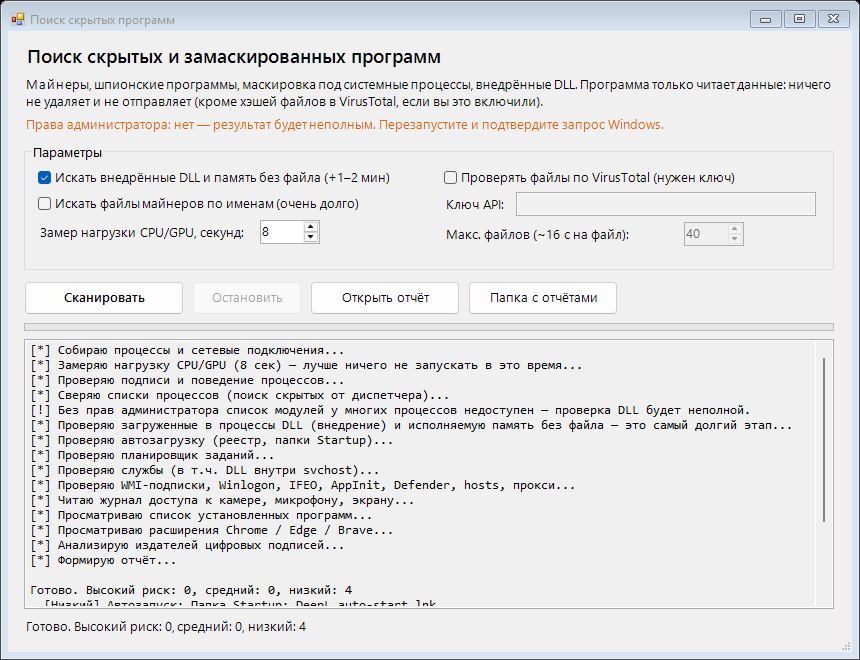

# Hidden App Scanner — поиск скрытых программ в Windows

**Русский** · [English](#english)

Программа с окном, которая ищет на **вашем** компьютере признаки скрытых майнеров, шпионского ПО и вредоносных программ, замаскированных под системные процессы. Результат — понятный HTML-отчёт с объяснением, *почему* каждый пункт подозрителен.

> **Только чтение.** Программа ничего не удаляет, не меняет и не отправляет в интернет. Единственное исключение — по вашему желанию хэши (не файлы) могут уходить в VirusTotal.

## Быстрый старт

1. Скачайте репозиторий: **Code → Download ZIP**, распакуйте.
2. Дважды щёлкните **`Start-GUI.bat`** и подтвердите запрос Windows (права администратора нужны, чтобы видеть все процессы и службы).
3. Нажмите **«Сканировать»**. Полный скан занимает 2–5 минут. Отчёт откроется сам и сохранится в папке `reports\`.

Без интерфейса: `Run-Scan-Console.bat` или `powershell -ExecutionPolicy Bypass -File .\Scan-HiddenApps.ps1`.

Требуется Windows 10/11 и встроенный Windows PowerShell 5.1. Ничего устанавливать не нужно.

## Что проверяется

| Область | Признаки |
|---|---|
| **Маскировка** | системное имя (`svchost.exe`, `lsass.exe`…) не из `System32`; похожее имя (`svch0st`); неверный родительский процесс; `svchost` без `-k`; двойное расширение; смесь латиницы и кириллицы в имени |
| **Подписи** | нет подписи, подпись недействительна, файл изменён после подписания; издатель подписи не совпадает с производителем в свойствах файла |
| **Майнеры** | командная строка (`stratum+tcp`, `--donate-level`, …), имена известных майнеров, порты майнинг-пулов, постоянная нагрузка CPU/GPU у неподписанной программы |
| **Слежка** | кейлоггеры и программы мониторинга, программы удалённого доступа (по процессам и списку установленных), журнал Windows о доступе к камере, микрофону, экрану и геолокации |
| **Внедрение** | неподписанные DLL и DLL из пользовательских папок внутри системных процессов; исполняемая память без файла |
| **Закрепление** | автозапуск (реестр, Startup), планировщик, службы (включая DLL внутри `svchost`), WMI-подписки, Winlogon, IFEO, AppInit_DLLs |
| **Защита и сеть** | исключения Defender, отключённая защита, файл `hosts`, системный прокси, скрытые учётные записи, нестандартные расширения браузеров |
| **Репутация (по желанию)** | сверка SHA256 с VirusTotal — это единственный способ поймать файл, подписанный краденым сертификатом |

## Как читать отчёт

Каждая находка имеет уровень (высокий / средний / низкий) и список причин. **Это не вердикт**, а признаки: многие нормальные программы не подписаны или лежат в `AppData`. Смотрите, узнаёте ли вы программу, и при сомнении проверьте файл по ссылке у SHA256-хэша.

Чего программа **не видит**: руткиты уровня ядра и вредоносные драйверы (нужна проверка вне системы, например Microsoft Defender Offline), слежку на роутере, телефоне и в облачных аккаунтах.

## Проверка по VirusTotal (необязательно)

1. Бесплатный ключ: [virustotal.com](https://www.virustotal.com) → профиль → **API key**.
2. В окне поставьте галочку «Проверять файлы по VirusTotal» и вставьте ключ. Ключ хранится только в памяти запуска.
3. В консоли: `$env:VT_API_KEY='ключ'; .\Scan-HiddenApps.ps1 -UseVirusTotal -VtMax 60`.

Уходят **только SHA256-хэши**, не файлы. Бесплатный лимит — 4 запроса в минуту, поэтому 60 файлов проверяются около 16 минут.

## Параметры консольной версии

| Параметр | Что делает |
|---|---|
| `-SampleSeconds N` | длительность замера нагрузки CPU/GPU (по умолчанию 8) |
| `-SkipModules` | не проверять загруженные DLL (быстрее) |
| `-DeepFiles` | искать файлы майнеров по именам в пользовательских папках (долго) |
| `-UseVirusTotal` `-VtMax N` | сверка хэшей с VirusTotal |
| `-NoElevate` / `-NoOpen` | не запрашивать права администратора / не открывать отчёт |

## Честно о ложных срабатываниях

- Антивирусы могут насторожиться: скрипт перечисляет процессы, службы и модули — так делают и вредоносные программы. Код открыт, читайте его.
- Приложения из Microsoft Store подписаны не через Authenticode, а драйверные компоненты — сертификатом Microsoft для драйверов (WHQL). Такие случаи учтены, но редкие исключения возможны.
- Нормальные программы разработчика (Git, Node, игровые лаунчеры) иногда дают низкий уровень риска.

Используйте только на своих компьютерах или с разрешения владельца.

## Лицензия

MIT — см. [LICENSE](LICENSE).

---

## English

**Hidden App Scanner** is a read-only Windows tool with a simple GUI that looks for signs of hidden crypto-miners, spyware and malware masquerading as system processes on **your own** machine, and writes an HTML report explaining *why* each item looks suspicious.

**Quick start:** download the ZIP, double-click `Start-GUI.bat`, approve the UAC prompt, press *Scan* (2–5 min). Requires Windows 10/11 and the built-in Windows PowerShell 5.1.

**What it checks:** process masquerading (wrong path/parent, look-alike names), code signatures (missing, invalid, publisher ≠ file vendor), miner indicators (command lines, pool ports, sustained CPU/GPU), stalkerware and remote-access tools, camera/microphone/screen-capture access log, injected DLLs and executable memory without a backing file, persistence (Run keys, Startup, scheduled tasks, services incl. `svchost` ServiceDll, WMI subscriptions, Winlogon, IFEO, AppInit), Defender exclusions, hosts file, proxy, browser extensions, and optional SHA256 reputation lookup on VirusTotal (hashes only, never files).

**Limits:** results are indicators, not verdicts. Kernel-level rootkits and malicious drivers are out of reach for any user-mode tool — use offline scanning (e.g. Microsoft Defender Offline). Antivirus products may flag the script because it enumerates processes and modules; the source is open for review. Use only on machines you own or are authorized to audit.

License: MIT.
