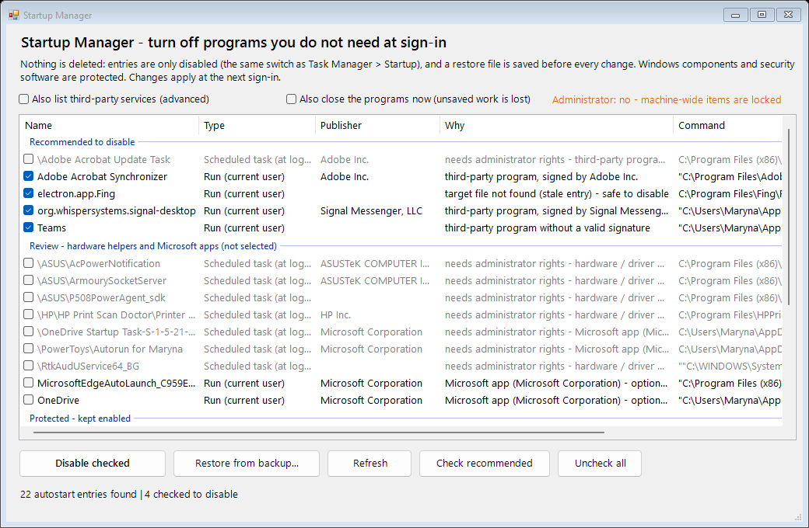

# Hidden App Scanner

A read-only Windows tool with a simple GUI that looks for signs of hidden crypto-miners, spyware and malware masquerading as system processes on **your own** computer. It writes an HTML report that explains *why* each item looks suspicious.


> **Read-only.** The tool never deletes, modifies or uploads anything. The only optional network use is sending file **hashes** (never the files) to VirusTotal, and only if you turn that on.

## Quick start

1. Download the repository: **Code -> Download ZIP**, then extract it.
2. Double-click **`Start-GUI.bat`** and approve the Windows prompt. Administrator rights are needed to see all processes and services.
3. Press **Scan**. A full scan takes 2-5 minutes. The report opens automatically and is saved in the `reports\` folder.

Without the GUI: run `Run-Scan-Console.bat`, or `powershell -ExecutionPolicy Bypass -File .\Scan-HiddenApps.ps1`.

Requires Windows 10/11 and the built-in Windows PowerShell 5.1. Nothing to install.

## What it checks

| Area | Indicators |
|---|---|
| **Masquerading** | system names (`svchost.exe`, `lsass.exe`, ...) outside `System32`; look-alike names (`svch0st`); wrong parent process; `svchost` without `-k`; double extensions; Latin/Cyrillic mixed in a file name |
| **Signatures** | no signature, invalid signature, file changed after signing; signing publisher differs from the vendor in the file properties |
| **Miners** | command lines (`stratum+tcp`, `--donate-level`, ...), names of known miners, mining-pool ports, sustained CPU/GPU load from an unsigned program |
| **Spyware** | keyloggers and monitoring software, remote-access tools (running processes and installed programs), Windows' own log of camera, microphone, screen-capture and location access |
| **Injection** | unsigned DLLs and DLLs from user-writable folders inside system processes; executable memory without a backing file |
| **Persistence** | Run keys, Startup folders, scheduled tasks, services (including the DLL behind `svchost`), WMI subscriptions, Winlogon, IFEO, AppInit_DLLs |
| **Protection & network** | Defender exclusions, disabled protection, `hosts` file, system proxy, hidden local accounts, browser extensions with broad permissions or sideloaded |
| **Reputation (optional)** | SHA256 lookup on VirusTotal - the practical way to catch a file signed with a stolen certificate |

## Startup Manager (optional, changes your system - reversibly)

The scanner itself is read-only. A separate tool, **`Start-StartupManager.bat`** (or the *Startup manager...* button in the main window), lets you switch off programs you do not need at sign-in.



- **Nothing is deleted.** Run-key and Startup-folder entries are only *disabled*, using the same switch as Task Manager > Startup. Scheduled tasks are disabled; services (opt-in) are switched to *Manual*.
- **A restore file is written before every change** to `backups\`. *Restore from backup...* (or `-Restore <file>`) puts everything back exactly as it was.
- **Protected, cannot be selected:** Windows system components and security software (Windows Security, Defender, Bitdefender, Kaspersky, ...).
- **Pre-checked ("Recommended"):** third-party programs - chat clients, launchers, updaters, stale entries.
- **Left unchecked ("Review"):** hardware/driver helpers (ASUS, NVIDIA, Realtek, ...) that may drive hotkeys, audio, touchpad or fans, and Microsoft apps such as OneDrive. You decide.
- Changes apply at the next sign-in. "Also close the programs now" additionally ends running copies (unsaved work is lost).

Console use:

```powershell
.\Manage-Startup.ps1 -List                                  # show everything, nothing changes
.\Manage-Startup.ps1 -DisableRecommended -DryRun            # preview
.\Manage-Startup.ps1 -DisableRecommended -Only 'Adobe|Fing' # only entries matching a regex
.\Manage-Startup.ps1 -Restore .\backups\startup-YYYYMMDD-HHMMSS.json
```

Administrator rights are needed for all-users entries, scheduled tasks and services; without them those rows are shown but locked.

## Reading the report

Every finding has a level (high / medium / low) and a list of reasons. **This is not a verdict** - these are indicators. Many legitimate programs are unsigned or live in `AppData`. Look at whether you recognize the program, and when in doubt check the file with the SHA256 link on the card.

What the tool **cannot see**: kernel-level rootkits and malicious drivers (use an offline scan such as Microsoft Defender Offline), surveillance on your router or phone, and compromised cloud accounts.

## VirusTotal check (optional)

1. Get a free key: [virustotal.com](https://www.virustotal.com) -> your profile -> **API key**.
2. In the GUI tick "Check files on VirusTotal" and paste the key. The key only lives in memory for that run.
3. In the console: `$env:VT_API_KEY='your-key'; .\Scan-HiddenApps.ps1 -UseVirusTotal -VtMax 60`.

**Only SHA256 hashes** are sent, never files. The free tier allows 4 requests per minute, so 60 files take about 16 minutes.

## Console parameters

| Parameter | Effect |
|---|---|
| `-SampleSeconds N` | length of the CPU/GPU sampling window (default 8) |
| `-SkipModules` | skip the loaded-DLL check (faster) |
| `-DeepFiles` | search user folders for miner files by name (slow) |
| `-UseVirusTotal` `-VtMax N` | look up file hashes on VirusTotal |
| `-NoElevate` / `-NoOpen` | do not ask for administrator rights / do not open the report |

## False positives, honestly

- Antivirus products may get suspicious: the script enumerates processes, services and modules, which malware does too. The source is open - read it.
- Microsoft Store apps are not Authenticode-signed, and some driver components carry Microsoft's driver (WHQL) certificate. These cases are handled, but rare exceptions are possible.
- Developer tools (Git, Node, game launchers) may occasionally show up at a low level.

Use only on computers you own or are authorized to audit.

## License

MIT - see [LICENSE](LICENSE).
